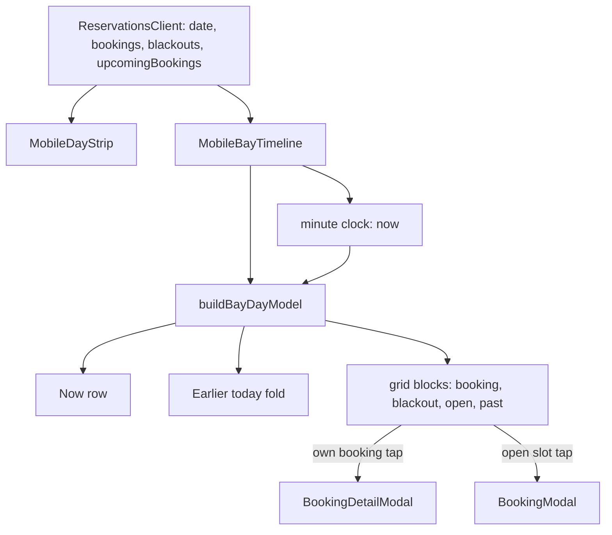
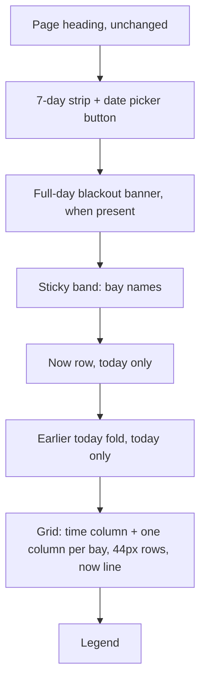

# Mobile All-Bays Booking View - Plan

## Goal Capsule

- **Objective:** A member opening Reservations on a phone sees, without scrolling sideways, who is at the club right now and the whole day's bookings across every bay, and can book an open slot from that same screen.
- **Means:** A new phone-only all-bays timeline replaces the current mobile list and tab toggle (KTD1, KTD2).
- **Authority:** Product Contract requirements win on behavior. KTDs win on mechanism. The approved mockup (Sources) illustrates layout and tone but does not override an R-ID.
- **Execution profile:** One PR from a `feat/*` branch to `main`, per the repo's trunk-based flow in `CLAUDE.md`. No migrations, env vars, or server-action changes.
- **Stop conditions:** Stop and ask if the club has more than 5 active bays at implementation time (R2 assumes 4–5), or if a requirement turns out to need a schema or server-action change.
- **Finishing:** `ce-work` implements and verifies. The user ships it via `/staging-pr`, then `/deploy-prod`.

---

## Product Contract

### Summary

Make an all-bays timeline the only mobile booking view. It shows every bay side by side at phone width, pins the bay names while scrolling, and adds a "Now" row showing who is on each bay. It also replaces the arrow-based date picker with a 7-day strip. Desktop, the booking and booking-detail modals, the booking rules, and the data layer stay as they are.

### Problem Frame

Members mainly open Reservations on their phones to see who else will be at the club, and the mobile screen hides that. It opens on "By Bay", a list of one bay at a time, so seeing the club means switching between four tabs. The "All Bays" option reuses the desktop table: it has a 600px minimum width and sits in a box capped at 70% of the screen height, so members have to scroll sideways and up and down inside a smaller box on the page. Members have asked for All Bays as the default, and the current All Bays view is awkward enough that it doesn't fix the complaint.

The current mobile All Bays view also has two gaps. It doesn't pass `onBookingClick` to `BayGrid`, so members can't tap their own booking there. The full-day blackout banner only renders on desktop.

### Requirements

**Layout**

- R1. On viewports narrower than Tailwind's `sm` breakpoint (640px), Reservations shows one all-bays view. The By Bay list, the By Bay / All Bays toggle, and the Next Available row are removed.
- R2. All active bays appear as side-by-side columns that fit the viewport with no horizontal scrolling, down to a 320px-wide screen.
- R3. The timeline scrolls with the page, not inside a nested scroll box. The bay-name header row stays pinned to the top of the screen while the member scrolls.
- R4. Each 30-minute row is at least 44px tall, so every open slot is a comfortable tap target.

**Who's at the club**

- R5. When viewing today during opening hours, a "Now" row under the bay names shows each bay's status. A busy bay shows the current booker's short name and end time ("You" for the member's own booking). Guest counts appear on the booking block, not in this row, so the row stays readable at 320px. A free bay shows "Open" and when its next booking starts. A blacked-out bay shows the blackout reason. The row refreshes every minute.
- R6. Other members' bookings show the booker's short name (first name + last initial), plus guest count when the block is tall enough. Each block's height matches the booking's length, and other members' blocks can't be tapped.
- R7. The member's own bookings are labelled "You". Tapping one opens the existing booking detail modal.
- R8. When viewing today, a gold line marks the current time across the timeline, with the time shown in the time column.

**Booking**

- R9. Tapping an open future slot opens the existing booking modal for that bay and start time.
- R10. Past slots and blacked-out slots can't be tapped. Blacked-out slots show the blackout reason.
- R11. When viewing today, rows that start before the current hour fold into one "Earlier today" row. That row shows the folded time range and how many bookings it hides, and tapping it expands them. Other days show the full 8 am–10 pm day with nothing folded.

**Date navigation**

- R12. A strip of 7 day buttons starting at today replaces the arrow navigation. A dot marks days where the member has an upcoming booking. A date-picker button reaches any date up to 90 days out, the same limit as desktop.
- R13. A full-day, all-bays blackout shows the same "Bays Unavailable" banner on mobile that desktop shows, and that day's grid can't be tapped.

**Theming and scope**

- R14. The view is readable in light, dark, high-contrast, and dark + high-contrast modes, using the existing override approach. The member's own bookings are green in light mode and gold in dark mode, matching the current grid.
- R15. The desktop layout (640px and wider) does not change.

### Key Decisions

- **All Bays is the only mobile view.** The By Bay tab is dropped rather than kept as an option, because one clear view is the point of the redesign and the new grid makes a single-bay list unnecessary. (session-settled: user-approved — chosen over keeping a By Bay toggle: proposed in scoping, confirmed after the mockup.) Governs R1.
- **"Now" row is the one new signature element.** It answers "who's at the club" directly. Everything else stays restrained and on-brand. (session-settled: user-approved — chosen over no live-status element: proposed in scoping, confirmed after the mockup.) Governs R5.
- **Next Available is removed.** Open slots are visible directly in the grid. (session-settled: user-approved — chosen over keeping the chip row: proposed in scoping, confirmed after the mockup.) Governs R1.
- **Short names in narrow columns.** Columns are about 60–80px wide, so full names don't fit. Other members' blocks stay non-interactive for privacy, as they are today. Governs R6.

### Acceptance Examples

- AE1. **Covers R5, R11.** **Given** it is 5:40 pm today, Bay 1 is booked 4:30–6:30 by Marcus Thompson with 1 guest, and Bay 2's next booking starts at 6:00. **When** the member opens Reservations. **Then** the Now row shows "Marcus T." with "til 6:30" under Bay 1 and "Open" with "til 6:00" under Bay 2. An "Earlier today" row covers 8 am–5 pm, and Marcus's block starts at the 5 pm row, cut off at the top.
- AE2. **Covers R5, R11.** **Given** it is 10:15 pm today, after closing. **When** the member opens Reservations. **Then** no Now row or now line shows, the whole day is folded into "Earlier today", and a short message says the bays are closed for today and points to tomorrow in the day strip.
- AE3. **Covers R5, R8, R11.** **Given** the member picks Saturday in the day strip. **Then** no Now row, now line, or Earlier row shows, and the grid starts at 8 am.
- AE4. **Covers R7, R9.** **Given** the member taps their own 7 pm block, they see the booking detail modal. **Given** they tap an open 6:30 Bay 3 slot, they see the booking modal set to Bay 3 at 6:30 pm.
- AE5. **Covers R5.** **Given** it is 7:30 am today, before opening. **Then** no Now row shows, and the grid starts at 8 am.

### Scope Boundaries

- The booking modal, booking detail modal, upcoming-reservations sheet (`UpcomingReservationsMobile`), booking validation, and server actions don't change.
- The desktop `BayGrid` layout doesn't change, except for deleting its phone-only scroll hint, which no longer renders anywhere.
- Considered and not built: tapping another member's booking to see who they're with. It's a privacy change the request didn't ask for. Revisit if members ask for it.
- Considered and not built: a fixed tablet layout between 640px and the desktop width. Tablets already get the desktop grid, and nobody has complained about it.

#### Deferred to Follow-Up Work

- Move the kiosk's inline per-bay status logic in `app/display/bay-status-view.tsx` onto the new `lib/utils/bay-day-model.ts` helper, so both screens share one definition of "who's on now".
- A layout for more than 5 active bays on phones (see Stop conditions).

---

## Planning Contract

### Key Technical Decisions

- KTD1. **New mobile component instead of restyling `BayGrid`.** `components/reservations/mobile-bay-timeline.tsx` replaces `components/reservations/mobile-bay-list.tsx` (deleted). The awkward scrolling comes from the desktop table's `min-w-[600px]` and its nested `max-h-[70vh]` scroll box. A separate phone component removes both and leaves desktop untouched (R15).
- KTD2. **CSS grid instead of a table.** The timeline is a CSS grid: a fixed time column plus one `minmax(0, 1fr)` column per bay, with 44px rows. Each booking spans its rows with a `grid-row` span. This lets booking blocks be real buttons with inset and radius, and makes a booking that starts in the folded "Earlier" range easy to draw cut off at the top. A table `rowSpan` can't do either cleanly.
- KTD3. **The view-model is a pure function, separate from rendering.** `lib/utils/bay-day-model.ts` builds the visible window, each bay's blocks (booking, blackout, open, past), the Now status, and the folded-earlier summary from bays, bookings, blackout periods, the selected date, a user id, and `now`. The component only renders that output. All time math is unit-tested with fixed dates. It reuses `generateTimeSlots`, `timeToSlotIndex`, and `durationToSpan` from `lib/utils/time-slots.ts` and `findBlackout` from `lib/utils/blackout.ts`.
- KTD4. **Header pinned by page-level sticky positioning.** The bay-name header uses `position: sticky; top: 0` against the page scroll. Neither `MemberNav` nor `main` in `app/(member)/layout.tsx` sets overflow on an ancestor, so sticky positioning works. No inner scroll container is added (R3).
- KTD5. **Theme through existing overridden utilities.** Wherever the meaning matches, reuse the classes that already have dark and high-contrast overrides in `app/globals.css`: `booking-mine` with `bg-navy` for own bookings, `bg-navy/[0.22]` for other members, and `text-navy/55` and `text-navy/65` for labels. Any new opacity or hover variant gets matching `html.dark-mode`, `html.high-contrast`, and combined overrides, per `CLAUDE.md`. No `useEffect`-based theming (R14).
- KTD6. **Reclaim side gutter on phones.** `main` pads 24px on each side. The timeline uses a negative horizontal margin on phones to get 12px gutters, so four columns stay readable at a 320px viewport (R2).
- KTD7. **A minute clock drives the live parts.** The timeline keeps a `now` state updated every 60 seconds, like `BayStatusView`. The Now row, the now line, and the Earlier fold point all derive from it. With past hours folded, today's view starts at the current hour without auto-scrolling, so `BayGrid`'s scroll-to-now logic stays desktop-only.
- KTD8. **Day-strip dots reuse data already loaded.** The dots come from `upcomingBookings`, which `ReservationsClient` already fetches, so no new query is needed (R12).
- KTD9. **Move `formatMemberName` to a shared module.** It moves from the deleted `mobile-bay-list.tsx` into `lib/utils/member-name.ts`, so the model and the Now row share one short-name rule (R5, R6).

### High-Level Technical Design

How the data flows into the mobile view:

Mobile page layout, top to bottom:

### Assumptions

- The club has 4 active bays (Bay 1, Bay 2, Bay 3, Big Bay, per migrations `20260311000000_rename_bay_5.sql` and `20260312000000_remove_bay_4.sql`). The layout is designed for 4–5.
- Moving the mobile date limit from 30 days to 90 matches desktop and the server's 3-month limit in `app/(member)/reservations/actions.ts`, so it adds no new booking ability.

---

## Implementation Units

### U1. Day view-model and shared name formatting

- **Goal:** A pure function that turns a day's bays, bookings, and blackouts into everything the timeline draws.
- **Requirements:** R5, R6, R8, R10, R11 (KTD3, KTD9)
- **Dependencies:** none
- **Files:**
  - `lib/utils/bay-day-model.ts` (create)
  - `lib/utils/member-name.ts` (create, moves `formatMemberName` there)
  - `tests/unit/bay-day-model.test.ts` (create)
- **Approach:**
  1. Window: for today during opening hours, start at the current hour's first slot and summarize everything earlier as `{ from, to, bookingCount }`. For other dates or before opening, use the full slot list with no summary. After closing, fold everything and flag the day as closed (AE2).
  2. Per bay: emit ordered blocks with a row start and span. Bookings that started in the folded range are cut to the window start and flagged `clippedStart`. Each booking block carries `mine`, short name, and guest count. Blackouts and past slots follow the same rules `BayGrid` uses today.
  3. Now status per bay (today and open only), checked in this order: the occupant with end time, then an active blackout with its reason, then "Open" with the next booking start or "rest of day". Blackout lookup uses `findBlackout` unchanged, so club-time (Pacific) handling and full-day blackouts behave as they do in `BayGrid`.
  4. Now-line offset as a fraction of the window, or none when not shown.
- **Patterns to follow:** the slot-mapping maps in `components/reservations/bay-grid.tsx`. The per-bay "free right now / until" logic in `app/display/bay-status-view.tsx`.
- **Test scenarios:**
  - Covers AE1. At 5:40 pm with a 4:30–6:30 Bay 1 booking, the window starts at 5 pm, the booking spans 3 rows flagged `clippedStart`, and Bay 1's Now status is the occupant ending 6:30.
  - Covers AE1. Bay 2 free at 5:40 with a 6:00 booking: status is Open until 6:00.
  - A bay free for the rest of the day has status Open with no end time.
  - A bay under a 5–9 pm partial blackout with no booking at 5:40 has a blackout status with its reason, not Open, and its slots in that range are blackout blocks.
  - A full-day all-bays blackout turns every slot on that date into a blackout block with no open slots.
  - The earlier summary counts bookings that start before the window, and counts a booking cut at the boundary once.
  - Covers AE2. At 10:15 pm the day is flagged closed, everything is folded, and there's no now offset.
  - Covers AE5. At 7:30 am there's no Now status and no fold, and the window starts at 8 am.
  - Covers AE3. A future date returns 28 rows, no fold, no Now status, and no now offset.
  - Own booking (member id matches) gets `mine: true`, and another member's doesn't.
  - `formatMemberName`: "Marcus Thompson" gives "Marcus T.", a single name stays as is, and null gives "Member".
- **Verification:** All scenarios pass with fixed dates via fake timers, matching the `tests/components/bay-status-view.test.tsx` setup.

### U2. Mobile day strip

- **Goal:** Pick a day in one tap, see which days you've booked, and reach dates up to 90 days out.
- **Requirements:** R12 (KTD8)
- **Dependencies:** none
- **Files:**
  - `components/reservations/mobile-day-strip.tsx` (create)
  - `tests/components/mobile-day-strip.test.tsx` (create)
- **Approach:** Seven equal-width buttons starting today: weekday abbreviation, date number, booking dot. Selected state: green fill in light mode, gold in dark (KTD5). A trailing calendar icon button wraps a native `input type="date"` limited to today through today + 90 days, like the desktop picker in `app/(member)/reservations/reservations-client.tsx`. Picking a date past the strip keeps the strip on today's week and adds a selected label for the picked date. Every button has an `aria-label` with the full date and "you have a booking" when relevant.
- **Test scenarios:**
  - Renders 7 buttons starting at today, with today selected by default.
  - Tapping Sunday calls `setDate` with Sunday at start of day.
  - A day with an upcoming booking shows a dot and its aria-label mentions the booking. A day without one doesn't.
  - Picking a date 40 days out through the date input calls `setDate` with that date, and the picked-date label appears.
  - The date input's `max` is today + 90 days.
- **Verification:** Tests pass. At 320px the strip and icon button fit one row without overflow.

### U3. Mobile all-bays timeline

- **Goal:** The new phone view: pinned bay names, Now row, Earlier fold, and the grid with booking blocks, open slots, blackouts, the now line, and a legend.
- **Requirements:** R2, R3, R4, R5, R6, R7, R8, R9, R10, R11, R14 (KTD1, KTD2, KTD4, KTD5, KTD6, KTD7)
- **Dependencies:** U1
- **Files:**
  - `components/reservations/mobile-bay-timeline.tsx` (create)
  - `tests/components/mobile-bay-timeline.test.tsx` (create)
- **Approach:**
  1. Props match today's `MobileBayList` minus `setDate`: bays, bookings, date, userId, blackoutPeriods, onSlotClick, onBookingClick.
  2. Sticky bay-name band on a `bg-navy-dark` background (same as the desktop table header), then the Now row in a cream band, then the Earlier toggle. Earlier starts collapsed and resets when the date changes.
  3. Grid per KTD2. Open future slots are `button`s labelled "Book <bay> at <time>". Own bookings are buttons with the `booking-mine bg-navy` treatment. Other members' bookings and blackouts are non-interactive elements.
  4. Now line placed absolutely from the model's offset, with a small gold time tag in the time column. It's decorative, so `aria-hidden`.
  5. A compact legend (You, Members, Open, Blocked) under the grid.
- **Execution note:** Build against the approved mockup (Sources) at 375px first, then check 320px and 430px.
- **Patterns to follow:** `BayGrid` cell styling vocabulary and legend, `BayStatusView` minute ticker, and the mockup's spacing.
- **Test scenarios:**
  - Covers AE1. With fake time 5:40 pm and fixture bookings, the Now row shows "Marcus T." "til 6:30" under Bay 1 and "Open" under Bay 2.
  - Covers AE4. Tapping the open Bay 3 6:30 pm button calls `onSlotClick` with Bay 3's id, name, and 6:30 pm.
  - Covers AE4. Tapping the member's own block calls `onBookingClick` with that booking and bay name.
  - Another member's block isn't a button and has no click handler.
  - A past open slot and a blacked-out slot render no button, and the blacked-out slot shows its reason text.
  - Earlier today starts collapsed and shows the range and count. Tapping it reveals the earlier rows and their bookings.
  - Covers AE3. On a future date there's no Now row, no Earlier row, and the first time label is 8 am.
  - Covers AE2. After closing, the closed-for-today message renders and no open-slot buttons exist.
  - Advancing fake time by 30 minutes updates the Now row, for example Bay 2 turns occupied at 6:00.
  - With 4 bays, each bay header renders exactly once in the sticky band.
- **Verification:** Tests pass. In a browser at 320, 375, and 430px there's no horizontal scroll, the band stays pinned while scrolling, and slot rows measure at least 44px.

### U4. Wire into the reservations page and remove the old mobile view

- **Goal:** Phones get the new view, desktop doesn't change, and dead code is gone.
- **Requirements:** R1, R7, R12, R13, R15
- **Dependencies:** U2, U3
- **Files:**
  - `app/(member)/reservations/reservations-client.tsx` (modify)
  - `components/reservations/mobile-bay-list.tsx` (delete)
  - `components/reservations/bay-grid.tsx` (modify: remove the `sm:hidden` scroll hint)
- **Approach:**
  1. In the `sm:hidden` block, render `MobileDayStrip`, then the full-day blackout banner (the same markup as desktop, pulled into a small local component so both layouts share it), then `MobileBayTimeline`, then the existing `UpcomingReservationsMobile`.
  2. Pass `onBookingClick` through so own bookings open `BookingDetailModal`. This fixes the current All Bays gap.
  3. A full-day blackout needs no extra gating here: U1 already turns every slot into a blackout block, so no open-slot buttons render.
  4. Leave the desktop block's props and markup as they are, apart from the shared banner extraction.
- **Test scenarios:**
  - Test expectation: none beyond U2 and U3. This unit is composition and deletion, covered by the component tests and the build. Confirm in the browser that the mobile toast still sits above the upcoming-reservations FAB.
- **Verification:** `rg MobileBayList` finds nothing. Desktop at 1280px looks the same as before, and a full-day blackout date shows the banner on mobile.

### U5. Dark and high-contrast coverage

- **Goal:** All four theme combinations look right on the new view.
- **Requirements:** R14 (KTD5)
- **Dependencies:** U2, U3
- **Files:**
  - `app/globals.css` (modify: add overrides only for utilities U2 and U3 introduced that don't already have them)
- **Approach:** List every color utility class the new components use. For each opacity, hover, or active variant without an `html.dark-mode` rule, add one, plus an `html.dark-mode.high-contrast` rule where the existing pattern has one, grouped under a "Reservations — mobile timeline" comment next to the existing Reservations overrides. The cream Now band and the Earlier row need explicit dark backgrounds that match the mockup's dark screen.
- **Test scenarios:**
  - Test expectation: none -- styling only. Verify visually instead.
- **Verification:** Toggle each mode in `/account` and view `/reservations` at 375px. Your bookings are gold in dark mode, other members' bookings are deep green, the Now row and labels stay readable, and nothing shows a light-mode background in dark mode.

---

## Verification Contract

| Gate | Command / check | Proves |
|---|---|---|
| Unit + component tests | `pnpm test` | U1–U3 scenarios, including AE1–AE5 |
| Lint | `pnpm lint` | Repo style rules |
| Types + build | `pnpm build` | Type safety and no dangling imports after deleting `mobile-bay-list.tsx` |
| Mobile visual check | `pnpm dev`, `/reservations` at 320, 375, 430px | R2, R3, R4: no sideways scroll, pinned header, row height |
| Theme check | All four modes from `/account` preferences | R14 |
| Desktop regression | `/reservations` at 1280px | R15 |

CI (`.github/workflows/ci.yml`) runs type check, lint, test, and build on the PR.

---

## Definition of Done

- Every R1–R15 is met, and AE1–AE5 are covered by passing tests.
- `MobileBayList`, the By Bay toggle, and the Next Available code are gone from the repo, and nothing imports them.
- The mobile and theme checks in the Verification Contract were done and pass.
- Desktop reservations look and behave as before.
- No leftover or experimental code from abandoned approaches is in the diff.

---

## Sources

- Approved mockup (light and dark phone screens): https://claude.ai/artifact/9D2YRF285APe5n2AanXp9s. It's private to the plan's author and illustrative only. The Requirements govern any disagreement, and an unreachable mockup doesn't block the work.
- Current mobile view: `components/reservations/mobile-bay-list.tsx`. Desktop grid: `components/reservations/bay-grid.tsx` (`min-w-[600px]`, `max-h-[70vh]`).
- Per-bay live status precedent: `app/display/bay-status-view.tsx` and `tests/components/bay-status-view.test.tsx`.
- Theme overrides: `app/globals.css`, Reservations section (`bg-navy/[0.22]`, `booking-mine`, `text-navy/65`, `text-navy/55`).
